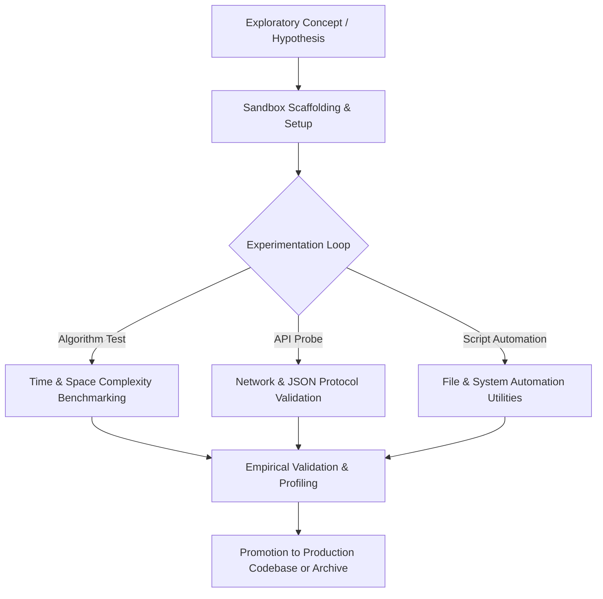

<div align="center">


[](https://www.python.org/)
[](https://www.java.com/)
[](#)
[](#)

</div>

---

## 📌 Executive Summary / Overview

The **Personal Software Engineering Lab** (`personal`) is a personal sandboxing, proof-of-concept prototyping, and exploratory scripting repository.

Software engineering innovation thrives on rapid iteration: testing bleeding-edge library releases, prototyping algorithmic edge cases, experimenting with alternative architectural patterns, and benchmarking computational performance before promoting features to production repositories. This lab provides an isolated environment for continuous technical exploration.

---

## 📖 Interactive Table of Contents

- [Executive Summary / Overview](#-executive-summary--overview)
- [Key Features & Capabilities](#-key-features--capabilities)
- [System Architecture & Prototyping Pipeline](#-system-architecture--prototyping-pipeline)
- [Tech Stack Breakdown](#-tech-stack-breakdown)
- [Exploratory Lab Workstreams](#-exploratory-lab-workstreams)
- [Reproducible Quickstart & Setup](#-reproducible-quickstart--setup)
- [Project Directory Layout](#-project-directory-layout)
- [Author & Contributions](#-author--contributions)

---

## ✨ Key Features & Capabilities

- **Frictionless Sandboxing**: Rapid experimental sandbox for testing language features in Python 3.10+ and Java 17+.
- **Algorithmic Edge-Case Benchmarks**: Microbenchmarks evaluating execution latency and memory overhead across competing data structures.
- **Proof-of-Concept Prototyping**: Fast turnaround for API proofs of concept, CLI utilities, and exploratory data scripts.
- **Defensive Error Exploration**: Safe environment to induce, test, and document edge-case runtime exceptions and failure recoveries.
- **Continuous Learning Sandbox**: Serves as an ongoing laboratory for technical exploration across software development paradigms.

---

## 🏗️ System Architecture & Prototyping Pipeline



---

## 🛠️ Tech Stack Breakdown

| Category | Technologies & Tools |
| :--- | :--- |
| **Languages** | Python 3.9+, Java (JDK 17+) |
| **Paradigms** | Procedural, Object-Oriented, Functional Scripting |
| **Tooling** | Virtualenv, VS Code, Git CLI |
| **Environment** | Local Sandbox / Interactive REPL |

---

## 🔬 Exploratory Lab Workstreams

| Workstream | Focus | Expected Artifacts |
| :--- | :--- | :--- |
| **Algorithmic Experiments** | Heuristic searches, graph traversals, dynamic programming | Python & Java benchmarking scripts |
| **Automation Utilities** | Batch file manipulation, system health scripts | Shell & Python terminal helpers |
| **Modern Language Features**| Pattern matching, record types, async streams | Compact reproducible demo snippets |

---

## 🚀 Reproducible Quickstart & Setup

### Prerequisites
- Python 3.9+ or Java JDK 17+ installed

### Step 1: Clone the Repository
```bash
git clone https://github.com/Jeshwanthika07/personal.git
cd personal
```

### Step 2: Initialize Virtual Environment
```bash
python -m venv venv
# On Windows:
.\venv\Scripts\activate
# On Linux/macOS:
source venv/bin/activate
```

---

## 📂 Project Directory Layout

```text
personal/
│
├── README.md                  # Comprehensive personal lab documentation
└── LICENSE                    # Open-source MIT license
```

---

## 👩‍💻 Author & Contributions

Authored by **[Jeshwanthika Pothamchetty](https://github.com/Jeshwanthika07)**  
*Alliance University | Department of Computer Applications*

<div align="center">


</div>
